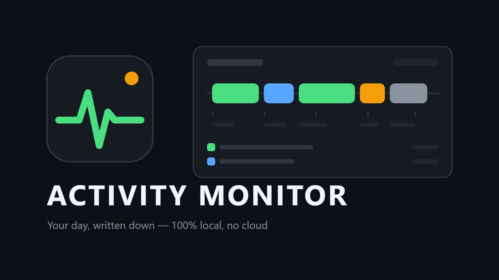

<p align="center">
  
</p>

# Activity Monitor — Windows + macOS (Rust port)

Lightweight desktop app that monitors user activity through window focus
tracking, idle detection, and triggered capture with AI-powered activity
analysis via a local Ollama model (Qwen3-VL). On Windows the capture is a
screen frame; on macOS it is text only (accessibility text of the frontmost
app, no screenshots), because macOS never allows silent screen capture.

This is the Rust port of the original .NET app. The SQLite database is
byte-compatible with the .NET build, so both read and write the same
`ActivityData.db`. See `RELEASE_NOTES.md` for the list of C# defects fixed
during the port. The original .NET build is untouched in `publish/`; the Rust
build deploys to `publish2/`.

## Features

- **Activity Tracking**: foreground window + idle detection via Win32 APIs
  (Windows) or CoreGraphics + Accessibility (macOS, v1.4)
- **Smart Screen Capture**: GDI `BitBlt` of the virtual screen, JPEG q75,
  low-FPS burst on triggers (Windows). On macOS the default `axtext`
  backend sends frontmost app + window title + accessibility text instead,
  and no screenshot is ever taken
- **AI Analysis**: Qwen3-VL via Ollama `/api/chat` with structured output
- **Queue System**: priority-based processing with backpressure
- **Event Storage**: SQLite timeline (`ActivityEvents` + `InferenceResults`)
- **CLI Tools**: timeline, detailed, summary, stats, report (JSON / LLM)
- **MCP Server**: read-only agent access to your activity day (Model Context
  Protocol, spec 2026-07-28)

## Requirements

- **Windows 10/11 (64-bit)** — the release executables are statically linked
  (no .NET runtime or VC++ redistributable needed)
- **Nothing else**: on first run the service creates `Data\ActivityData.db`
  automatically, and if Ollama is missing it downloads the official release
  zip into `%LOCALAPPDATA%\Programs\Ollama`, starts `ollama serve`, and pulls
  `qwen3-vl:2b` (startup blocks until the model is ready; ~2 GB download on
  first run). Set `ACTIVITY_MONITOR_OLLAMA_EXE` to use a specific ollama.exe.
  If the download fails the service keeps monitoring and logs the manual fix.
- **Alternative inference runtime (v1.2)**: set `"OllamaApiStyle": "openai"`,
  point `OllamaEndpoint` at any OpenAI-compatible server (e.g. Foundry Local's
  `http://127.0.0.1:5273/v1` — start it with `foundry service start`, list models
  with `foundry model list`, run one with `foundry model run <alias>`; a vision
  alias such as `phi-4-multimodal-instruct` on Copilot+ PCs gets NPU inference)
  and set `OllamaModel` to the served model id. With this style the service
  never installs/starts/pulls anything — it only probes the endpoint and logs
  the fix if the server or model is missing. LM Studio and Windows ML's
  WinMLServer work the same way.
- **macOS 13+ (Apple Silicon or Intel, v1.4)**: download `publish2-macos-v1.4.0.zip`
  from the release page, see "macOS" below. The release binaries are ad-hoc
  signed; Developer ID signing and notarization come later (they need a paid
  Apple Developer account).
- **Rust toolchain** only if building from source

## Installation (from source)

```cmd
cargo build --release --workspace
powershell -File deploy.ps1       REM copies exes + appsettings.json to publish2\
```

Or just use the prebuilt `publish2\` folder.

## macOS (v1.4)

1. Download `publish2-macos-v1.4.0.zip` from the release page and unzip it.
2. Run `./install-macos.sh` from the unzipped folder. It copies the three
   binaries + `appsettings.json` to `~/Library/Application Support/ActivityMonitor`
   and registers a per-user launchd agent (`com.greathavoc.activitymonitor`),
   so the service starts at login and restarts if it crashes.
   `./install-macos.sh uninstall` stops and removes the agent.
3. Inference needs Ollama, which the service will not install for you on a
   Mac: `brew install ollama`, then `ollama serve` in a terminal and
   `ollama pull qwen3-vl:2b` (or set `OllamaApiStyle: "openai"` for another
   local runtime). If Ollama is down, monitoring continues and the log says
   what to run.
4. Grant the agent the Accessibility permission: System Settings > Privacy &
   Security > Accessibility, add `activity-monitor-service`. Without it the
   service records idle events only. Screen Recording is not needed: the
   `axtext` backend never captures the screen.

Data locations on macOS: the database is
`~/Library/Application Support/ActivityMonitor/Data/ActivityData.db` (the CLI
and MCP server resolve it the same way as on Windows), logs go to
`~/Library/Logs/ActivityMonitor` and `<install dir>/Logs`. CLI and MCP usage
is identical to Windows, e.g.
`~/Library/Application Support/ActivityMonitor/activity-monitor-cli stats`.

## MCP server (agent access to your day)

`activity-monitor-mcp.exe` exposes the recorded timeline to MCP clients
(Claude, Cursor, Copilot, …) over the same SQLite file. Stdio by default;
Streamable HTTP on 127.0.0.1 with `--http <port>`; `--db <path>` or
`ACTIVITY_MONITOR_DB` picks the database (default: the same
`./Data/ActivityData.db` resolution as the CLI). The database is opened
`SQLITE_OPEN_READONLY`, so the server never blocks or writes to the service.

| Tool | What it answers |
|---|---|
| `todays_timeline` | every recorded event for a day, with AI labels |
| `session_summary` | time per app, category distribution, labels seen |
| `activity_at` | what was on screen in a window around a timestamp |
| `daily_report` | structured JSON report for a day |
| `search_activity` | hybrid search over past days: FTS5-ranked lexical + trigram fuzzy (typos/shared vocabulary), RRF-merged, `from`/`to`/`limit` |
| `ask_about_my_day` | free-form question answered by the local model, grounded only in your data |
| `weekly_digest` | 7-day "shape of your work" digest as Markdown: events, context switches, top apps, category mix, topics, busiest hours |

Example (stdio, one request per line):

```json
{"jsonrpc":"2.0","id":1,"method":"tools/call","params":{"name":"search_activity","arguments":{"query":"tableau","from":"2026-11-10","to":"2026-11-17","limit":5}}}
```

Point your client at it, e.g. Claude Code: `claude mcp add activity-monitor -- path\to\activity-monitor-mcp.exe`.

Provenance for agents: the repo ships `server.json` (MCP server card) and
every release carries a `SHA256SUMS.txt` asset plus a GitHub attestation, so
a client can verify the binary before connecting. All tools are read-only
(`readOnlyHint: true`); the server opens the database read-only and binds
HTTP to 127.0.0.1 only.

## Privacy & consent

- **Everything is local.** Captured frames, the database, and the AI model all
  stay on this machine. There is no cloud endpoint, no telemetry, and no
  account — nothing in this app can send your screen anywhere.
- **Capture is invisible to you while running on Windows** (no consent picker,
  no capture border, no notification) by design — GDI `BitBlt`, never Windows
  Graphics Capture. On macOS (v1.4) no screen image is captured at all: the
  `axtext` backend reads only the frontmost app, window title and accessibility
  text, because macOS shows a mandatory recording indicator for any screen
  capture. That makes this a *single-user self-monitoring* tool. Using it to
  monitor employees or other people is not what it is for, and workplace
  surveillance laws (EU AI Act, California AB 1331, 2026) require informed
  consent, no covert recording, and data minimization.
- **You control the data.** `Data\ActivityData.db` is a plain SQLite file:
  delete it to purge everything, or back it up to keep it. Old events are
  auto-compacted after `MaxEventAgeDays` (default 90), and AI summaries are
  purged together with their events. Frames are not retained unless
  `RetainFrames: true`.
- **Export and exclude (v1.3).** `activity-monitor-cli.exe export --from ... --to ... --format md|json`
  writes your whole history (events plus AI summaries) to a file you own,
  which also covers GDPR-style portability and erasure requests (export,
  then delete the DB). `ExcludedProcesses` in `appsettings.json` lists apps
  that are never recorded: no focus event and no capture while they are in
  the foreground (match by process name, with or without `.exe`, case
  insensitive).
- **Workplace use.** This is a self-monitoring tool. If it is ever pointed at
  another person, workplace surveillance rules apply (EU AI Act high-risk
  duties for worker-management systems have been enforceable since
  2026-08-02; California AB 1331; GDPR). Those regimes require informed
  consent, no covert recording and data minimization, which this tool's
  design (local-only, no covert cloud sync, purge and export controls)
  supports, but consent itself is the deployer's responsibility.

## Auto-start

1. `Win + R`, type `shell:startup`
2. Create a shortcut to `C:\ActivityMonitor\publish2\activity-monitor-service.exe`
3. Name it "Activity Monitor"

To run as a real Windows service instead: `activity-monitor-service.exe --service`
(installed via `install-service.ps1` — run it elevated — or `sc create`),
or run it in a console with Ctrl+C to stop. On macOS the launchd agent
installed by `install-macos.sh` is the autostart; `launchctl stop/start
com.greathavoc.activitymonitor` controls it.

## Configuration

Edit `publish2\appsettings.json` (loaded from the exe's folder):

```json
{
  "ActivityMonitor": {
    "SamplingIntervalSeconds": 5,
    "IdleThresholdSeconds": 300,
    "CaptureSettings": {
      "FrameRate": 1, "MaxDurationSeconds": 30,
      "TriggerOnFocusChange": true, "TriggerOnIdleResume": true,
      "MaxFramesPerCapture": 1,
      "PeriodicCaptureIntervalSeconds": 180, "MinEventCaptureIntervalSeconds": 10,
      "CaptureAllMonitors": true, "CaptureBackend": "gdi",
      "ExcludedProcesses": []
    },
    "OllamaEndpoint": "http://localhost:11434",
    "OllamaModel": "qwen3-vl:2b",
    "OllamaApiStyle": "ollama",
    "QueueSettings": {
      "MaxConcurrentTasks": 4, "MaxQueueSize": 100,
      "HighPriorityThreshold": 10, "ProcessingTimeoutSeconds": 0
    },
    "Storage": {
      "DatabasePath": "Data\\ActivityData.db",
      "RetainFrames": false, "CompactionIntervalHours": 24, "MaxEventAgeDays": 90
    }
  }
}
```

`DatabasePath` is relative to the working directory, so run the service from
the `publish2` folder (the CLI resolves `.\Data\ActivityData.db` first).
`ProcessingTimeoutSeconds: 0` means the 120 s default (the C# code left the
HTTP timeout infinite); raise it (e.g. 600) on slow machines where the vision
model is cold — the clean-install drill needed it when Ollama was busy. `PeriodicCaptureIntervalSeconds` / `MinEventCaptureIntervalSeconds`
were hardcoded to 3 min / 10 s in the C# service and are now configurable
(defaults keep the old behavior). `CaptureAllMonitors: true` captures the
whole virtual screen (all monitors) in one frame instead of just the primary
display; the code default is `false`, matching the C# behavior. `CaptureBackend`
selects the capture path: `"gdi"` (default, the C# behavior) or `"dxgi"`
(Desktop Duplication — also silent, GPU-copied; any failure, including a
uniform/blank frame from an unsupported adapter, falls back to GDI for that
capture). On macOS (v1.4) `"axtext"` selects the text-only Accessibility
backend (the default there; any other value logs a warning and uses axtext),
and on Windows an unrecognized value falls back to GDI. `ExcludedProcesses` lists process names that are never recorded
(for example `["OneNote", "game.exe"]`); an empty list records everything.
Logs go to `<exe_dir>\Logs\`.

## CLI usage

```cmd
cd C:\ActivityMonitor\publish2
activity-monitor-cli.exe timeline --from "2026-11-15" --to "2026-11-16"
activity-monitor-cli.exe detailed --from "2026-11-15" --to "2026-11-16" --limit 50
activity-monitor-cli.exe summary --date "2026-11-15"
activity-monitor-cli.exe stats
activity-monitor-cli.exe report --from "2026-11-15" --to "2026-11-16" --output report.json
activity-monitor-cli.exe report --from "2026-11-15" --to "2026-11-16" --llm
activity-monitor-cli.exe report --week --output digest.md
activity-monitor-cli.exe export --from "2026-11-01" --to "2026-11-18" --format md --output my-history.md
activity-monitor-cli.exe query --from "2026-11-15" --to "2026-11-16" --limit 100
```

Report JSON schemas (v2.0 standard, v3.0-llm) are unchanged from the .NET
CLI; output is byte-identical except no UTF-8 BOM and `GeneratedAtUtc`.

## Development

```
Cargo.toml                  # workspace
crates/activity-monitor-core    # config, db, capture, sensors, ollama, queue
crates/activity-monitor-service # host loop (console / --service)
crates/activity-monitor-cli     # timeline/detailed/summary/stats/report/query
publish2/                       # Rust deploy target (publish/ = old .NET build)
```

```cmd
cargo test --workspace
cargo build --release --workspace
```

## Troubleshooting

- **"Database not found!"** from the CLI — run it from the folder containing
  `Data\ActivityData.db`, or make sure the service is running first.
- Service won't start — check `<exe_dir>\Logs\activity-monitor.YYYY-MM-DD`.
- No inference rows — `curl http://localhost:11434/api/tags` must list
  `qwen3-vl:2b`; connection errors fail fast (120 s timeout) and are logged.
- Corrupt DB — stop the service, delete `Data\ActivityData.db`, restart.
- macOS: only idle rows are recorded — the agent lacks the Accessibility
  permission (System Settings > Privacy & Security > Accessibility). No
  inference rows — Ollama is not running (`ollama serve`) or the model is not
  pulled (`ollama pull qwen3-vl:2b`); the service log prints the exact fix.

## License

MIT
